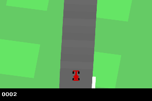
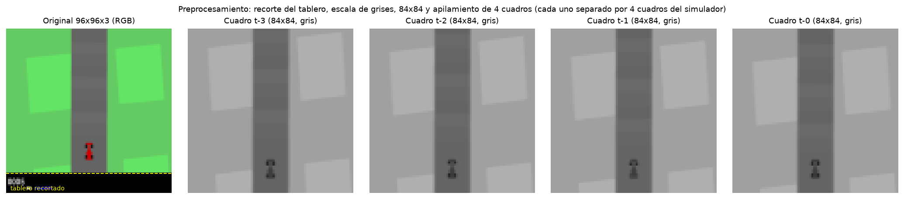
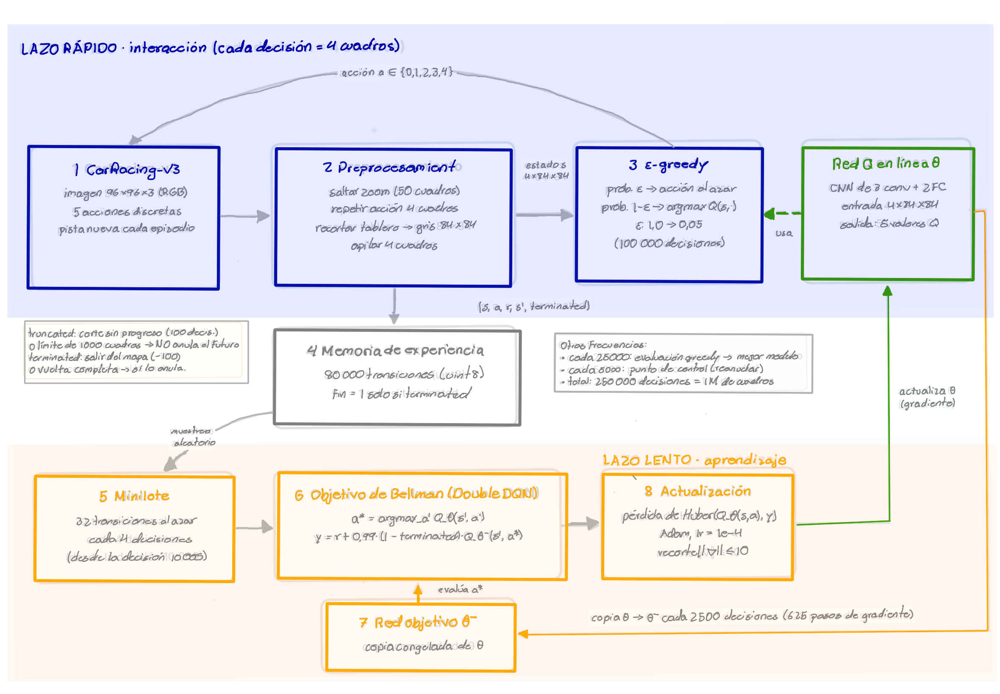
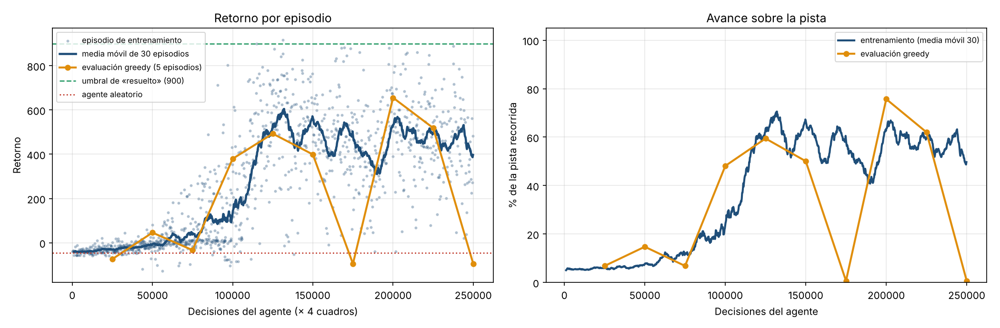
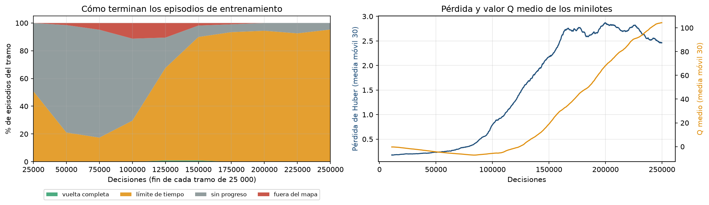
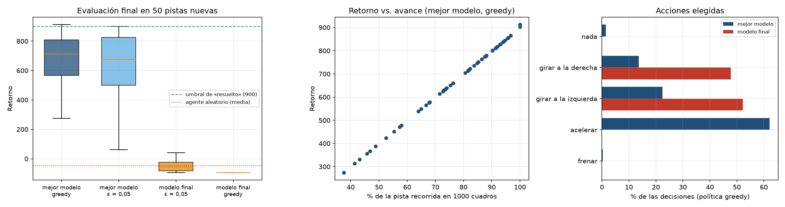
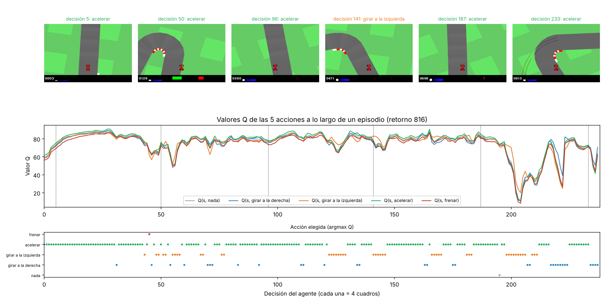

<div align="center">

# CarRacing-v3 con Deep Q-Network

*Un agente Double DQN que aprende a conducir a partir de la imagen de la cámara, implementado desde cero, evaluado en pistas nuevas y diagnosticado a fondo*

[](pyproject.toml)
[](https://gymnasium.farama.org/environments/box2d/car_racing/)
[](LICENSE)
[](https://colab.research.google.com/github/dialrigo/taller2-dqn-carracing/blob/main/notebooks/colab_carracing_dqn.ipynb)



[Resumen](#resumen) • [El ambiente](#el-ambiente-carracing-v3) • [Instalación y uso](#instalación-y-uso) • [Entrenamiento](#flujo-lógico-del-entrenamiento) • [Red neuronal](#red-neuronal-e-hiperparámetros) • [Resultados](#resultados-y-evidencia) • [Reflexiones](#reflexión-sobre-los-resultados)

</div>

---

## Resumen

Este repositorio resuelve el Taller 2 de Simulación y Aprendizaje por Refuerzo con un ambiente que no se trabajó en clase, [CarRacing-v3](https://gymnasium.farama.org/environments/box2d/car_racing/) de Gymnasium. El agente controla un auto visto desde arriba y debe recorrer una pista que cambia en cada episodio, de modo que no puede memorizar un recorrido y tiene que aprender a reconocer la pista en la imagen. Para lograrlo entrenamos desde cero un **Double DQN** con la red convolucional de Mnih et al. (2015), usando la versión de acciones discretas del ambiente.

**Grupo 10**, Maestría en Inteligencia Artificial, Universidad de La Sabana<br>
Diego Ríos · Nataly Valbuena · Lorena Valero · Nicolas Gamboa · Jorge Anaya · Andrés Díaz · Marlon Umbarila

### Qué incluye este repositorio

- **Un DQN escrito a mano**, con la red, la memoria de experiencia, la red objetivo y el ciclo de entrenamiento implementados directamente en PyTorch, de modo que cada parte del algoritmo se puede leer y modificar.
- **Un pipeline reproducible**, en el que un mismo archivo de configuración alimenta el entrenamiento, la evaluación y todas las figuras de este documento, y en el que cada experimento queda registrado en MLflow.
- **Evidencia versionada**, con el registro episodio a episodio, las evaluaciones periódicas, la evaluación final en 50 pistas nuevas, los modelos entrenados y el video del agente.
- **Un diagnóstico propio** del colapso del modelo final, que se puede repetir con un solo comando.
- **Un notebook para Google Colab**, para quien prefiera ejecutar todo sin instalar nada.

### Resultado en pocas palabras

| Agente (50 pistas nuevas) | Retorno medio | Pista recorrida | Supera 700 puntos | Sale del mapa |
|---|---:|---:|---:|---:|
| Mejor modelo, política greedy | **665,0 ± 171,9** | 76,6 % | 54 % | 0 % |
| Modelo final, política greedy | −95,0 ± 0,0 | 0,7 % | 0 % | 0 % |
| Agente aleatorio, como referencia | −46,0 ± 18,6 | 5,6 % | 0 % | sin registro |

El agente entregado conduce con soltura en pistas que nunca vio, recorre en promedio tres cuartas partes del circuito y nunca se sale del mapa. Aun así, no alcanza el umbral de 900 puntos que define el ambiente como resuelto, porque casi nunca completa la vuelta en los 1000 cuadros disponibles. Además, el modelo del final del entrenamiento colapsó y se quedó inmóvil, así que entregamos el mejor punto de control y dedicamos buena parte del análisis a entender por qué ocurrió.

---

## El ambiente CarRacing-v3

CarRacing-v3 pertenece a la familia Box2D de Gymnasium y es el único ambiente de esa familia cuya observación es una imagen, ya que LunarLander y BipedalWalker entregan vectores. Por eso el agente necesita una red convolucional que aprenda a distinguir la pista del pasto. Usamos la versión de acciones discretas (`continuous=False`), que es la que admite DQN.

### Observación

| | Ambiente original | Entrada de la red, tras el preprocesamiento |
|---|---|---|
| Tipo | `Box(0, 255, (96, 96, 3), uint8)` | `Box(0, 255, (4, 84, 84), uint8)` |
| Contenido | Imagen RGB de la cámara cenital y tablero inferior con velocidad, ABS, giroscopio, volante y puntaje | 4 cuadros consecutivos en escala de grises, sin tablero |
| Rango | enteros de 0 a 255 | enteros de 0 a 255, divididos por 255 dentro de la red |



El preprocesamiento está en `src/carracing_dqn/envs.py`, y cada paso responde a una razón concreta.

| Paso | Qué hace | Por qué |
|---|---|---|
| Saltar el zoom inicial | Avanza 50 cuadros con la acción «nada» al reiniciar | Cada episodio arranca con un zoom de cámara en el que la imagen cambia sin que el agente controle nada, así que la red no debe aprender de esos cuadros. |
| *Frame skip* de 4 | Repite cada acción 4 cuadros y suma las recompensas | Dos cuadros seguidos son casi idénticos a 50 FPS. Decidir cada 4 cuadros divide el costo por 4 y hace que cada acción tenga un efecto visible. |
| Recorte del tablero | Elimina las 12 filas inferiores, de 96 a 84 filas | El tablero no es pista y muestra el puntaje, de modo que la red podría correlacionar ese número con el retorno en lugar de aprender a conducir. |
| Escala de grises | Pasa de RGB a 1 canal | La pista gris, el pasto verde y los bordes rojos y blancos se distinguen por intensidad, mientras que el color triplicaría la entrada sin aportar información útil. |
| 84 × 84 | Redimensiona con interpolación por área | Es el tamaño de la arquitectura de Mnih et al. (2015) y deja dimensiones enteras en las convoluciones, de 20, 9 y 7. |
| Apilar 4 cuadros | El estado son los 4 últimos cuadros procesados | Una sola imagen no es un estado markoviano, porque muestra dónde está el auto pero no hacia dónde ni qué tan rápido va. Con 4 cuadros, que abarcan 16 cuadros del simulador, la red infiere velocidad, dirección y giro, igual que en los juegos de Atari vistos en clase. |

Al reiniciar, la pila se llena con cuatro copias del primer cuadro, de modo que el estado inicial siempre muestra el auto detenido y sin historia. Este detalle parece menor, pero resulta decisivo para entender el colapso que analizamos en la reflexión sobre los resultados.

### Acciones

El espacio de acciones es `Discrete(5)`, con dtype `int64`.

| Acción | Efecto | Valor que aplica el simulador |
|:---:|---|---|
| 0 | nada, el auto rueda por inercia | sin control |
| 1 | girar a la derecha | dirección de 0,6 a la derecha |
| 2 | girar a la izquierda | dirección de 0,6 a la izquierda |
| 3 | acelerar | acelerador de 0,2, de 1,0 posible |
| 4 | frenar | freno de 0,8 |

Como no se puede acelerar y girar en la misma acción, el agente tiene que alternar decisiones, y tomar curvas rápidas le resulta más difícil que en la versión continua. Además, la versión discreta usa valores fijos y moderados, por lo que el auto gana velocidad de forma gradual y frenar resulta comparativamente brusco. Estos valores los verificamos directamente en `gymnasium/envs/box2d/car_racing.py`, en Gymnasium 1.4.0.

### Recompensas

| Evento | Recompensa |
|---|---|
| Cada cuadro que pasa | −0,1, es decir −0,4 por decisión con *frame skip* de 4 |
| Cada baldosa nueva de la pista | +1000/N, donde N es el número de baldosas de esa pista, cerca de 300 (por ejemplo 319 con la semilla 0), unos 3 puntos por baldosa |
| Salir del área de juego, con \|x\| o \|y\| mayor que 333 | −100, que reemplaza la recompensa del cuadro y termina el episodio |

Una baldosa solo paga la primera vez que se pisa, así que recorrer toda la pista en *k* cuadros da 1000 − 0,1·*k*. El ambiente se considera resuelto con 900 puntos de media (`spec.reward_threshold = 900`), lo que equivale a completar la vuelta en menos de 1000 cuadros. En la práctica, esto significa que no basta con conducir bien, sino que también hay que conducir rápido.

### Terminación del episodio

| Condición | Tipo | Recompensa |
|---|---|---|
| Vuelta completa, al visitar todas las baldosas o al volver a la salida tras visitar más del 95 % (`lap_complete_percent=0.95`) | `terminated` | la acumulada |
| El auto sale del área de juego | `terminated` | −100 |
| Se alcanzan 1000 cuadros, unas 238 decisiones tras el zoom | `truncated`, por límite de tiempo | sin recompensa adicional |
| Solo en entrenamiento, 100 decisiones seguidas sin recompensa positiva | `truncated`, por un corte propio | sin recompensa adicional |

---

## Instalación y uso

El proyecto usa [uv](https://docs.astral.sh/uv/) para el entorno, con las dependencias en `pyproject.toml` y las versiones fijadas en `uv.lock`, y [MLflow](https://mlflow.org/) para registrar cada experimento.

```bash
git clone https://github.com/dialrigo/taller2-dqn-carracing.git
cd taller2-dqn-carracing
uv sync
```

En Windows recomendamos Python 3.12 (`uv sync --python 3.12`), porque con Python 3.14 el paquete `box2d-py` no compila. Si prefieres no instalar nada, el notebook [`notebooks/colab_carracing_dqn.ipynb`](notebooks/colab_carracing_dqn.ipynb) ejecuta el mismo código en Google Colab con GPU.

### Explorar el ambiente y la red

```bash
uv run python scripts/explorar_ambiente.py      # espacios, preprocesamiento y agente aleatorio
uv run python scripts/resumen_red.py            # arquitectura de la red con dimensiones reales
```

### Entrenar

```bash
uv run python -m carracing_dqn.train                                # entrenamiento completo, usa GPU si existe
uv run python -m carracing_dqn.train --pasos 3000 --nombre prueba   # verificación rápida, unos 3 minutos
uv run python -m carracing_dqn.train --reanudar                     # retoma un entrenamiento interrumpido
```

### Evaluar y regenerar la evidencia

```bash
uv run python -m carracing_dqn.evaluate          # evaluación en 50 pistas nuevas, figura de la política y GIF
uv run python -m carracing_dqn.plots             # figuras de docs/figuras
uv run python scripts/diagnostico_colapso.py     # diagnóstico del colapso del modelo final
uv run mlflow ui --backend-store-uri sqlite:///mlflow.db   # tablero de experimentos en http://127.0.0.1:5000
```

La verificación rápida con la semilla 42 produce exactamente las mismas cifras en clones limpios de Windows y Linux, con un retorno medio de −37,5, −37,9 y −42,4 a las 1 000, 2 000 y 3 000 decisiones, y una evaluación greedy de −73,9 ± 7,0. El entrenamiento completo, en cambio, no se reproduce bit a bit entre máquinas, como explicamos en las conclusiones de los resultados.

---

## Estructura del repositorio

```
configs/dqn_carracing.yaml     # única fuente de hiperparámetros
src/carracing_dqn/
├── envs.py                    # ambiente y cadena de preprocesamiento
├── model.py                   # red Q convolucional
├── replay.py                  # memoria de experiencia en uint8, en disco y reanudable
├── agent.py                   # política ε-greedy, red objetivo y actualización de Bellman
├── train.py                   # ciclo de entrenamiento, MLflow y puntos de control
├── evaluate.py                # evaluación final, visualización de la política y GIF
├── plots.py                   # figuras de resultados
└── utils.py                   # configuración, semillas y métricas de la pista
scripts/                       # exploración del ambiente, resumen de la red y diagnóstico
notebooks/                     # versión para Google Colab
results/                       # registros por episodio, evaluaciones y métricas finales
models/                        # modelo entregado y modelo final
docs/                          # diagrama del ciclo, figuras y GIF del agente
```

| Ruta | Contenido | Cuándo entrar aquí |
|---|---|---|
| `configs/dqn_carracing.yaml` | Todos los hiperparámetros del ambiente, el entrenamiento y la evaluación. | Para cambiar un experimento sin tocar el código. |
| `src/carracing_dqn/envs.py` | La cadena de *wrappers* que salta el zoom, repite acciones, recorta, convierte a gris y apila cuadros. | Para entender qué ve exactamente la red. |
| `src/carracing_dqn/agent.py` | La política ε-greedy, la red objetivo y la actualización de Bellman con Double DQN. | Para revisar el núcleo del algoritmo. |
| `src/carracing_dqn/train.py` | El ciclo de entrenamiento, las evaluaciones periódicas, los puntos de control y el registro en MLflow. | Para reproducir o reanudar el entrenamiento. |
| `results/` | El retorno de cada episodio, las evaluaciones periódicas, la evaluación final y la línea base aleatoria. | Es la fuente de todas las cifras de este documento. |
| `models/` | El mejor punto de control, que es el modelo entregado, y el modelo del final del entrenamiento. | Para evaluar el agente sin entrenarlo de nuevo. |
| `scripts/diagnostico_colapso.py` | El experimento que explica por qué el modelo final se queda inmóvil. | Para verificar la reflexión sobre los resultados. |
| `docs/` | El diagrama propio del ciclo de entrenamiento, las figuras y el GIF del agente. | Para ver o reutilizar las gráficas sin regenerarlas. |

---

## Flujo lógico del entrenamiento



El ciclo está implementado en `src/carracing_dqn/train.py` y `agent.py`. Escrito en pseudocódigo, se ve así.

```
inicializar Q_θ (CNN) con pesos aleatorios;  Q_θ⁻ ← Q_θ;  memoria D vacía (80 000)
para paso = 1 … 250 000 decisiones:
    ε ← decaimiento lineal 1,0 → 0,05 durante 100 000 decisiones
    a ← aleatoria si paso ≤ 10 000 (llenado de la memoria); si no, ε-greedy sobre Q_θ(s, ·)
    ejecutar a durante 4 cuadros → s', r (suma), terminated, truncated
    guardar (s, a, r, s', terminated) en D                         # truncated NO se guarda como fin
    cada 4 decisiones:
        muestrear 32 transiciones de D
        a* ← argmax_a' Q_θ(s', a')                                  # la red en línea elige
        y  ← r + 0,99 · (1 − terminated) · Q_θ⁻(s', a*)             # la red objetivo evalúa
        minimizar Huber(Q_θ(s, a), y) con Adam;  ‖∇‖ ≤ 10
    cada 2 500 decisiones:  θ⁻ ← θ
    cada 25 000 decisiones (y en la última): evaluar la política greedy en 5 pistas fijas
        (semillas 10 000 a 10 004) y guardar el mejor modelo
    cada 5 000 decisiones:  punto de control (red, optimizador y memoria en disco) para reanudar
    si terminated o truncated: registrar el episodio en MLflow y reiniciar el ambiente (nueva pista)
guardar el modelo final (además del mejor modelo según la evaluación periódica)
```

Verificamos cada línea del pseudocódigo contra el código. Hay, sin embargo, tres detalles que el pseudocódigo no deja ver. En primer lugar, ε empieza a bajar desde la primera decisión, así que cuando termina el llenado de la memoria ya vale cerca de 0,90. En segundo lugar, la memoria guarda de *s'* solo el cuadro nuevo, porque los otros 3 ya están en *s*, y gracias a eso cada transición ocupa 5 cuadros en vez de 8, un 37 % menos de espacio. Por último, las 5 pistas de la evaluación periódica son distintas de las 50 de la evaluación final, que usa las semillas 1000 a 1049, de modo que elegir el mejor modelo no toma información de la prueba.

Cada componente de DQN cumple una función precisa dentro de este ciclo.

- **Memoria de experiencia.** Los cuadros consecutivos de una vuelta están muy correlacionados, de modo que entrenar con ellos en orden violaría el supuesto de datos independientes del descenso de gradiente y haría que la red olvidara las curvas vistas hace un minuto. Muestrear al azar entre 80 000 transiciones rompe esa correlación y, además, reutiliza cada experiencia, porque con 32 muestras por cada 4 decisiones nuevas cada transición se usa en promedio unas 8 veces mientras está en la memoria.
- **Exploración ε-greedy.** Al principio el agente no sabe que acelerar sobre la pista paga, así que la exploración aleatoria es la que genera esas primeras experiencias. ε baja de 1 a 0,05 en 100 000 decisiones y luego se mantiene en 0,05 para seguir corrigiendo errores.
- **Red objetivo.** Si el objetivo *y* se calculara con la misma red que se actualiza, cada paso de gradiente movería también el objetivo y el valor Q oscilaría. Por eso usamos una copia congelada que se actualiza cada 2 500 decisiones, es decir, cada 625 pasos de gradiente.
- **Actualización de Bellman con Double DQN.** Q(s, a) se ajusta hacia r + γ·Q(s′, a*). En Double DQN la red en línea elige a* y la red objetivo lo evalúa, lo que reduce la sobreestimación propia del operador máximo (van Hasselt et al., 2016).

---

## Particularidades del ambiente

CarRacing tiene varias características que obligan a adaptar el DQN clásico. La siguiente tabla resume cada una, por qué importa y cómo la abordamos.

| Particularidad | Por qué importa | Cómo se abordó |
|---|---|---|
| Observación en píxeles | El estado no son variables físicas sino una imagen, así que el agente debe aprender a reconocer la pista. | Red convolucional y el preprocesamiento descrito arriba. |
| Una imagen no es markoviana | Sin historia no se sabe la velocidad ni el sentido del giro. | Apilar 4 cuadros. |
| Pista distinta en cada episodio | No se puede memorizar un recorrido, de modo que hay que generalizar a curvas nuevas. | Evaluación final en 50 pistas que nunca se usaron en el entrenamiento. |
| Zoom de cámara al inicio | Los primeros 50 cuadros son una transición visual sin control. | Se saltan al reiniciar. |
| Recompensa por baldosa nueva, una sola vez | Volver por la pista ya recorrida no paga y quedarse quieto cuesta −0,1 por cuadro. | Un corte del episodio de entrenamiento tras 100 decisiones sin recompensa positiva, que evita llenar la memoria con el auto detenido o girando en el pasto. |
| Salir del área de juego cuesta −100 | Es la única recompensa grande y negativa, por lo que produce objetivos de Bellman mucho mayores en magnitud que el resto y, si se repite, el agente aprende a evitar los bordes del mapa. | Se marca como `terminated`, porque es un fin real sin futuro que estimar, y la pérdida de Huber limita el gradiente de esos errores grandes. |
| Escala de recompensa variable y sin recortar | Cada baldosa paga 1000/N y N cambia con la pista, mientras que una decisión sin avance suma −0,4. A diferencia de Atari, las recompensas no se recortan a [−1, 1]. | Conservamos la escala original para que el retorno sea comparable con el umbral de 900, y la pérdida de Huber junto con el recorte de gradiente (‖∇‖ ≤ 10) mantienen estable el entrenamiento. |
| Menos agarre fuera de la pista | Sobre el pasto la fricción baja al 60 %, el auto derrapa y el efecto de una acción depende de dónde estén las ruedas. | No se modela explícitamente, aunque los 4 cuadros apilados permiten inferir el derrape y el corte sin progreso descarta los episodios atascados en el pasto. |
| La vuelta completa es un fin real | El episodio termina al visitar todas las baldosas o al volver a la salida tras recorrer más del 95 %. | Se marca como `terminated`, y la evaluación la reconoce con la señal `lap_finished` del propio ambiente (función `tipo_fin` de `utils.py`). |
| El corte propio no es un fin real | Si se tratara como terminal, el agente aprendería que detenerse acaba el episodio sin costo. | Se marca como `truncated`, de modo que el objetivo de Bellman sigue estimando el futuro, y la evaluación usa el ambiente sin ese corte. |
| Límite de 1000 cuadros | Tras el zoom quedan unas 238 decisiones, así que para resolver el ambiente hay que ir rápido. | Reportamos el porcentaje de pista recorrida además del retorno. |
| Acciones exclusivas | No se puede acelerar y girar a la vez. | El agente aprende a alternar ambas acciones, y analizamos su distribución en los resultados. |
| Costo de simulación | Box2D y el renderizado avanzan a unos 125 cuadros por segundo en CPU. | *Frame skip* de 4, memoria en disco y puntos de control para reanudar. |

---

## Red neuronal e hiperparámetros

### Arquitectura

La red sigue la arquitectura DQN de Mnih et al. (2015), con la salida reducida a 5 acciones (`src/carracing_dqn/model.py`). La tabla coincide con la salida de `uv run python scripts/resumen_red.py`, y además comprobamos a mano las dimensiones y los parámetros de cada capa.

| Capa | Configuración | Salida (C × H × W) | Parámetros |
|---|---|---|---:|
| Entrada | 4 cuadros de 84×84 en uint8, divididos por 255 | 4 × 84 × 84 | 0 |
| Conv 1 | 32 filtros, *kernel* 8×8, *stride* 4, ReLU | 32 × 20 × 20 | 8 224 |
| Conv 2 | 64 filtros, *kernel* 4×4, *stride* 2, ReLU | 64 × 9 × 9 | 32 832 |
| Conv 3 | 64 filtros, *kernel* 3×3, *stride* 1, ReLU | 64 × 7 × 7 | 36 928 |
| Aplanar | sin parámetros | 3 136 | 0 |
| Densa | 3 136 → 512, ReLU | 512 | 1 606 144 |
| Salida | 512 → 5, lineal | 5 valores Q(s, a), uno por acción | 2 565 |
| **Total** | | | **1 686 693** |

La dimensión de salida de cada convolución es ⌊(entrada − kernel)/stride⌋ + 1, lo que da (84 − 8)/4 + 1 = 20, luego (20 − 4)/2 + 1 = 9 y finalmente (9 − 3)/1 + 1 = 7.

Cada decisión de diseño responde a la naturaleza de la entrada. Usamos **convoluciones** porque la entrada es una imagen, y al compartir pesos por posición detectan los bordes de la pista y la posición del auto donde sea que aparezcan. Los **strides grandes al inicio**, con un *kernel* de 8×8 y *stride* 4, reducen rápido la resolución, ya que el detalle fino de 84×84 no hace falta para decidir y así se ahorra cómputo. Los **4 cuadros entran como 4 canales** de la primera convolución, de modo que la red compara cuadros consecutivos en la misma posición y extrae el movimiento. La **capa densa de 512** combina las 3 136 características espaciales en una representación de la situación, como una curva cercana, el auto desviado o una velocidad alta. La **salida es lineal y tiene 5 neuronas**, porque una sola pasada debe dar Q para todas las acciones y los valores Q no están acotados, mientras que una sigmoide o una tanh los saturarían. Por último, la **normalización ocurre dentro de la red**, en la primera operación, y gracias a eso la memoria guarda uint8 y ocupa 4 veces menos RAM que en float32.

### Hiperparámetros

Todos los valores están en `configs/dqn_carracing.yaml`. La tabla los compara con los de Mnih et al. (2015) y explica cada diferencia.

| Hiperparámetro | Valor | Mnih et al. (2015) | Razón |
|---|---|---|---|
| Decisiones de entrenamiento | 250 000, es decir 1 M de cuadros | 50 M de cuadros | Es el presupuesto que cabe en una jornada de CPU, unas 3,6 h. Son 50 veces menos que en Atari, y esa es una de las razones por las que el agente no llega al umbral de 900. |
| γ | 0,99 | 0,99 | Da un horizonte efectivo 1/(1 − γ) de unas 100 decisiones, es decir 400 cuadros u 8 s de simulación a 50 FPS. Cubre de sobra la llegada de una curva, que tarda 1 a 2 s, de modo que el agente puede valorar frenar o girar antes de salirse. |
| Optimizador y tasa de aprendizaje | Adam, 1 × 10⁻⁴ | RMSProp, 2,5 × 10⁻⁴ | Adam es el optimizador habitual en implementaciones modernas de DQN (Lapan, 2020), y con objetivos que se mueven una tasa menor evita que las convoluciones oscilen. |
| Tamaño del minilote | 32 | 32 | Es el mismo valor del artículo original. En CPU cada actualización tarda unos 35 ms. |
| Memoria de experiencia | 80 000 transiciones | 1 000 000 | Está limitada por la RAM, porque cada transición ocupa 35 280 bytes en uint8 (un estado de 4×84×84 y un cuadro nuevo de 84×84), unos 2,8 GB en total. Aun así cubre unos 340 episodios, suficiente para descorrelacionar los minilotes. |
| Inicio del aprendizaje | 10 000 decisiones | 50 000 cuadros | Llena la memoria con experiencia aleatoria antes de la primera actualización, para no entrenar sobre un puñado de transiciones muy parecidas. |
| Frecuencia de actualización | cada 4 decisiones | cada 4 acciones | Es el mismo valor del artículo y equilibra recolección y aprendizaje. Con minilotes de 32 cada 4 decisiones, cada transición se muestrea en promedio 32/4 = 8 veces mientras está en la memoria. |
| Sincronización de la red objetivo | cada 2 500 decisiones | cada 10 000 actualizaciones | Equivale a 625 actualizaciones con el objetivo fijo. Es más frecuente que en el artículo porque el entrenamiento es 50 veces más corto, y con 10 000 el objetivo cambiaría muy pocas veces. |
| ε inicial y final | de 1,0 a 0,05 en 100 000 decisiones | de 1,0 a 0,1 en 1 M de cuadros | La exploración es larga, el 40 % del entrenamiento, porque la recompensa positiva exige acelerar varias decisiones seguidas sobre la pista. El valor final de 0,05 es el que el artículo usa al evaluar. |
| Pérdida | Huber | error recortado a [−1, 1] | Equivale al recorte del error del artículo, porque es cuadrática cerca de 0 y lineal lejos, y además es robusta a los saltos de −100 al salir del mapa. |
| Recorte del gradiente | norma ≤ 10 | no se usa | Evita actualizaciones explosivas cuando los valores Q crecen. |
| Double DQN | activado | no se usa (van Hasselt et al., 2016) | La red en línea elige la acción y la red objetivo la evalúa, lo que reduce la sobreestimación de Q. |
| Corte sin progreso | 100 decisiones | no se usa | Ahorra cómputo en episodios estancados y solo se aplica en entrenamiento. |
| Semilla | 42 | no aplica | Reproducibilidad. |

---

## Resultados y evidencia

El entrenamiento cubrió 250 000 decisiones, que equivalen a 1 000 000 de cuadros y 1 186 episodios, en una CPU de 2 núcleos durante unas 3,6 horas y con la semilla 42. Todas las cifras de esta sección salen de los archivos de `results/`.

### Curva de aprendizaje



| Decisiones | Evaluación greedy en 5 pistas fijas | Pista recorrida |
|---:|---:|---:|
| 25 000 | −73,7 | 7 % |
| 50 000 | 45,9 | 15 % |
| 75 000 | −33,3 | 7 % |
| 100 000 | 379,7 | 48 % |
| 125 000 | 492,9 | 59 % |
| 150 000 | 399,1 | 50 % |
| 175 000 | −95,0, atascado | 1 % |
| **200 000** | **655,6, mejor punto de control** | **76 %** |
| 225 000 | 518,8 | 62 % |
| 250 000 | −95,0, atascado | 1 % |

El aprendizaje atraviesa tres fases bien diferenciadas. Durante la **exploración**, entre las decisiones 0 y 80 000, la media móvil de 30 episodios se mantiene entre −42 y 0 hasta la decisión 58 000, aproximadamente, es decir al nivel del agente aleatorio (−46), y solo después sube despacio hasta cerca de 50. En ese tramo, entre las decisiones 10 000 y 80 000, entre el 61 % y el 81 % de los episodios de cada tramo de 10 000 decisiones terminan por el corte sin progreso, porque el auto apenas avanza.

Luego llega el **despegue**, entre las decisiones 80 000 y 130 000. Con ε cayendo hacia 0,05, el agente aprende a acelerar sobre la pista y a corregir en las curvas, de modo que la media móvil sube de cerca de 50 a cerca de 580 y la proporción de episodios cortados sin progreso baja de alrededor del 64 % al 5 %. De hecho, el mejor episodio de entrenamiento, con 917,6 puntos y la vuelta completa, ocurre en la decisión 131 158.

Finalmente, entre las decisiones 130 000 y 250 000, el entrenamiento entra en una **meseta inestable** en la que la media móvil oscila entre 310 y 605. Para entonces el 93 % de los episodios acaba por límite de tiempo y solo el 0,6 % por salir del mapa, lo que muestra que el agente ya no se sale, pero tampoco alcanza a completar la vuelta en 1000 cuadros.



Llama la atención que la pérdida de Huber suba mientras el agente aprende, con una media móvil que pasa de 0,2 al inicio a un máximo de 2,9 cerca de la decisión 200 000. Sin embargo, no es una señal de error, sino la consecuencia esperable de que los objetivos de Bellman crezcan a medida que el agente encuentra recompensas, y en paralelo el valor Q medio de los minilotes pasa de cerca de 0 a cerca de 104.

### Evaluación final en 50 pistas nuevas

La evaluación usa las semillas 1000 a 1049, que no se usaron en el entrenamiento ni para elegir el modelo. Evaluamos el mejor punto de control, de la decisión 200 000, y el modelo final, de la decisión 250 000, tanto con política greedy (ε = 0) como con ε = 0,05, que es el protocolo de evaluación de Mnih et al. (2015).

| Agente | Retorno medio ± desv. | Mediana | Mínimo y máximo | Pista recorrida | ≥ 700 pts | Vueltas completas | Fuera del mapa |
|---|---:|---:|---:|---:|---:|---:|---:|
| **Mejor modelo, greedy** (`models/dqn_carracing_mejor.pt`) | **665,0 ± 171,9** | **713,5** | 273,9 a 912,7 | **76,6 %** | **54 %** | 4 % | **0 %** |
| Mejor modelo, ε = 0,05 | 635,0 ± 221,9 | 675,5 | 62,0 a 899,7 | 73,8 % | 46 % | 2 % | 2 % |
| Modelo final, ε = 0,05 | −48,8 ± 36,5 | −57,3 | −95,0 a 40,0 | 5,3 % | 0 % | 0 % | 0 % |
| Modelo final, greedy | −95,0 ± 0,0 | −95,0 | −95,0 a −95,0 | 0,7 % | 0 % | 0 % | 0 % |
| Agente aleatorio, como referencia | −46,0 ± 18,6 | sin registro | −81,3 a −5,3 | 5,6 % | 0 % | 0 % | sin registro |



El mejor modelo conduce con solidez. En promedio recorre el 76,6 % de pistas que nunca vio, nunca se sale del mapa y supera 700 puntos en el 54 % de ellas, aunque solo completa la vuelta en 2 de las 50 pistas, con un máximo de 912,7 puntos. Además, la selección del modelo no infló el resultado, porque el mejor punto de control se eligió con 5 pistas fijas (655,6) y en las 50 pistas nuevas obtiene 665,0, una cifra equivalente.

El panel central de la figura revela algo todavía más claro, y es que el retorno resulta una función casi exactamente lineal del avance, con un ajuste de retorno ≈ 1 002 × (fracción de pista) − 103 y un R² de 0,9998 en los 50 episodios. Dicho de otro modo, el límite no está en que el agente se equivoque de camino, sino en que no le alcanza el tiempo, ya que 48 de los 50 episodios terminan por el tope de 1000 cuadros.

El modelo final, en cambio, colapsó. Con política greedy queda inmóvil en las 50 pistas, y su −95 corresponde exactamente a −0,1 por cuadro durante los 950 cuadros del episodio, mientras que con ε = 0,05 rinde igual que un agente aleatorio. En la reflexión sobre los resultados explicamos por qué ocurre. En cualquier caso, el agente entregado no alcanzó el umbral de 900, aunque con 665 de media queda unos 711 puntos por encima del agente aleatorio.

### Visualización de la política



En un episodio completo de la pista 1000, con un retorno de 816, el agente acelera en las rectas, alterna giros cortos en las curvas (por ejemplo, a la izquierda en la curva cerrada de la decisión 141) y casi nunca frena. Si se miran los 50 episodios de evaluación, el mejor modelo elige acelerar en el 62 % de las decisiones, girar a la izquierda en el 22 % y a la derecha en el 14 %, mientras que «nada» y frenar suman menos del 2 %. Por su parte, los valores Q de las 5 acciones están muy cerca entre sí la mayor parte del tiempo y solo se separan en las curvas, y las caídas fuertes, entre las decisiones 200 y 220, coinciden con tramos en los que el auto se sale del borde de la pista y pierde recompensa.

### Conclusiones de los resultados

Con un DQN implementado desde cero y apenas 1 M de cuadros en CPU, el agente aprende a conducir desde píxeles. Pasa de −46, el nivel de un agente aleatorio, a 665 ± 172 en pistas nuevas, y recorre tres cuartas partes de la pista sin salirse. Su desempeño queda por debajo del umbral de 900 principalmente por velocidad, ya que ningún episodio greedy termina fuera del mapa y 48 de 50 se agotan por tiempo. Las salidas del borde de la pista que sí ocurren cuestan tiempo, pero no terminan el episodio.

Ahora bien, el entrenamiento es inestable. Dos de las diez evaluaciones periódicas, en las decisiones 175 000 y 250 000, encontraron al agente inmóvil, de modo que guardar el mejor punto de control fue indispensable, porque el modelo final no sirve.

Por último, el resultado no se reproduce bit a bit entre máquinas. La corrida corta de 3 000 decisiones da exactamente las mismas cifras en Windows y Linux con la semilla 42, pero una segunda corrida completa, hecha en otro equipo con la misma configuración y semilla, obtuvo su mejor punto de control en la decisión 125 000, con 554 ± 210 en las 50 pistas de evaluación frente a 665 ± 172 de la corrida reportada (detalle en el [*pull request* #4](https://github.com/dialrigo/taller2-dqn-carracing/pull/4)). Ambas corridas aprenden a conducir y ninguna resuelve el ambiente; sin embargo, la diferencia de unos 110 puntos muestra que 665 es una realización y no un valor esperado, y con solo dos corridas no es posible estimar la variabilidad con rigor.

---

## Reflexión sobre los resultados

### Qué aprendió el agente

A partir de solo 4 imágenes en gris, la red aprendió a distinguir la pista del pasto, a anticipar las curvas y a alternar la aceleración con giros cortos. Prefiere acelerar casi siempre y prácticamente no frena, lo cual tiene sentido, porque frenar no da recompensa inmediata y su beneficio, entrar a la curva sin salirse, llega varias decisiones después. Por eso es la acción que más le cuesta valorar a DQN con γ = 0,99 y un presupuesto corto de entrenamiento.

### Por qué no llega a 900

El ambiente se resuelve recorriendo toda la pista en menos de 1000 cuadros, pero nuestro agente mantiene una velocidad prudente y alterna giros, de modo que completa la vuelta solo en el 4 % de las pistas. Tres decisiones de diseño explican ese límite. La primera es que las acciones son exclusivas, ya que el agente no puede acelerar y girar a la vez como sí podría en la versión continua, y por lo tanto cada corrección en una curva es una decisión en la que no acelera. La segunda es que saltar el zoom inicial consume 50 de los 1000 cuadros disponibles. La tercera es el presupuesto, porque 1 M de cuadros es 50 veces menos que los 50 M por juego de Mnih et al. (2015), y la curva de aprendizaje no muestra que el agente haya agotado lo que puede aprender, sino que en ese presupuesto no llegó a estabilizarse.

### El colapso del modelo final

El colapso combina dos fallas distintas, que verificamos con `scripts/diagnostico_colapso.py` cargando los dos modelos entregados.

La primera es una trampa en el estado inicial. Tras el reinicio, los 4 cuadros apilados son idénticos, con el auto detenido, y los valores Q de las 5 acciones quedan casi empatados. El mejor modelo elige acelerar en las 50 pistas de evaluación, aunque con una ventaja media de solo 1,7 puntos sobre la segunda acción (en la pista 1000, 61,7 frente a 59,5 de «nada»). El modelo final, en cambio, elige girar en las 50 pistas, con una ventaja media de apenas 0,18 puntos (en la pista 1000, 93,4 para girar a la izquierda frente a 91,7 para acelerar). El problema es que girar con el auto detenido no lo mueve. La imagen siguiente difiere del cuadro inicial en 0,01 niveles de gris de media, apenas lo que cambian las ruedas, así que la red vuelve a ver el mismo estado y vuelve a elegir lo mismo. La política greedy queda atrapada en un bucle determinista y el auto nunca arranca, lo que da −0,1 por cuadro durante 950 cuadros, es decir −95 en todas las pistas.

La segunda falla es que el modelo final, además, conduce peor. Si forzamos 5 decisiones de aceleración al inicio y luego dejamos actuar a la red, en las primeras 20 pistas de evaluación el mejor modelo obtiene 615 ± 202, mientras que el modelo final solo llega a 107 ± 25. Así, la trampa explica el −95, pero aun sacándolo de ella el modelo final perdió buena parte de lo que había aprendido. En otras palabras, entre las decisiones 200 000 y 250 000 el entrenamiento no solo cambió el orden de las acciones en un estado poco frecuente, sino que degradó la política en general.

Ambas fallas se conectan con el diseño del problema. Para empezar, el estado inicial es poco frecuente en la memoria de experiencia, porque aparece una vez por episodio frente a unos 237 estados en movimiento, así que la red casi no recibe gradiente sobre él y su valor deriva con el resto del entrenamiento; con empates de décimas, cualquier deriva basta para cambiar la acción elegida. A esto se suma que el corte sin progreso oculta el problema durante el entrenamiento, ya que un episodio atascado se corta a las 100 decisiones y la exploración con ε = 0,05 a veces lo saca, de modo que la curva de entrenamiento no muestra el colapso y solo la evaluación greedy periódica lo detectó, dos veces, en las decisiones 175 000 y 250 000.

También vale la pena mirar los valores Q, que siguen creciendo mientras el retorno se estanca, ya que el Q medio de los minilotes pasa de cerca de 20 a cerca de 104 entre las decisiones 150 000 y 250 000. Esto, por sí solo, no prueba una sobreestimación. El mejor modelo gana unos 2,8 puntos por decisión (665/237), y con γ = 0,99 y el límite de tiempo tratado como truncamiento, ese ritmo vale 2,8/(1 − 0,99), unos 280, de modo que un Q de 104 bien puede ser un valor que todavía se está propagando. Lo que sí importa es la escala relativa, porque Q crece hasta cerca de 90 en el estado inicial mientras la diferencia entre acciones sigue en décimas, y entonces un error pequeño en el ajuste basta para cambiar la acción. Distinguir sobreestimación de propagación lenta requeriría comparar Q con el retorno descontado observado en cada estado.

Finalmente, la segunda corrida completa, con la misma semilla en otra máquina, eligió su mejor punto de control en la decisión 125 000 y obtuvo 554 ± 210. Que dos corridas difieran tanto, y que ambas tengan su mejor modelo antes del final, indica que la inestabilidad es propia del método con este presupuesto y no un accidente de una corrida en particular.

### Qué haríamos distinto

Lo primero sería seleccionar el modelo con evaluaciones greedy más frecuentes y con más pistas, descartando los puntos de control que se atasquen, porque esa práctica fue precisamente la que nos permitió entregar un modelo funcional. También arrancaríamos el episodio con el auto en movimiento, con unas decisiones fijas de aceleración tras el zoom. El diagnóstico muestra que esto elimina el −95, aunque no recupera el modelo final (107), así que complementa la selección del mejor punto de control pero no la sustituye.

Además, usaríamos una tasa de aprendizaje decreciente al final y entrenaríamos con más cuadros en GPU. Probaríamos *Dueling DQN*, que separa el valor del estado de la ventaja de cada acción y resulta útil justamente cuando las acciones valen casi lo mismo, como en el estado inicial, y *Prioritized Experience Replay*, para dar más peso a los estados poco frecuentes. Por último, repetiríamos el entrenamiento con varias semillas para estimar la variabilidad, ya que la diferencia entre nuestras dos corridas completas, de 665 frente a 554, muestra que hace falta.

---

## Reflexión sobre lo que más costó

Esta reflexión reúne las dificultades que cada integrante registró en su [*pull request*](https://github.com/dialrigo/taller2-dqn-carracing/pulls?q=is%3Apr) y las que aparecieron mientras construíamos y entrenábamos el agente.

### Dificultades técnicas

El primer obstáculo fue el **costo de cómputo**. CarRacing simula a unos 125 cuadros por segundo en CPU y cada actualización de la red convolucional tarda unos 35 ms, así que un millón de cuadros tomó cerca de 3,6 horas y no dejó margen para buscar hiperparámetros ni repetir semillas. Para colmo, el proceso se interrumpió en las primeras horas, de modo que tuvimos que implementar puntos de control cada 5 000 decisiones, con la memoria de experiencia en disco. Del mismo modo, el *frame skip* y la decisión de guardar solo el cuadro nuevo de *s′*, unos 35 KB por transición en lugar de 56 KB, fueron necesarios para que la memoria cupiera en la máquina.

Pronto descubrimos también que **la documentación del ambiente no alcanza**. La página de Gymnasium no detalla la magnitud de las acciones discretas, con una dirección de ±0,6, un acelerador de 0,2 y un freno de 0,8, ni la regla que da por completa la vuelta al 95 %, así que tuvimos que leer `car_racing.py` para confirmarlas. En ese mismo proceso, la figura de preprocesamiento parecía correcta, y solo al comparar píxeles notamos que el cuadro original y los apilados correspondían a instantes distintos, por la forma en que el script interactuaba con el zoom inicial.

La tercera dificultad técnica nos enseñó que **reproducir no es lo mismo que fijar una semilla**. La corrida corta da cifras idénticas en distintos equipos, pero la reproducción completa en otra máquina, con la misma semilla, terminó en 554 ± 210 en lugar de 665 ± 172. Reproducir exigió, además, resolver incompatibilidades de versiones, ya que `box2d-py` no compila con Python 3.14 en Windows y, con PyTorch 2.6 o superior, `torch.load` dejó de abrir los puntos de control, por lo que `--reanudar` fallaba hasta indicar `weights_only=False`.

### Dificultades conceptuales

En lo conceptual, la primera pregunta fue **por qué una imagen no basta**. Una imagen muestra dónde está el auto, pero no hacia dónde va ni qué tan rápido, y fue al relacionarlo con la propiedad de Markov vista en clase que entendimos y justificamos la entrada de 4 canales.

Igual de importante fue distinguir **terminación de truncamiento**. El corte por falta de progreso y el límite de 1000 cuadros no son fines reales del episodio, y si se marcan como terminales el objetivo de Bellman anula el valor futuro, de modo que el agente aprende que detenerse no cuesta nada. Se trata de una sola línea de código, `terminated` frente a `truncated`, pero tiene consecuencias en todo el aprendizaje.

Por otro lado, nos costó **adaptar los hiperparámetros de Atari**. Con 50 veces menos entrenamiento que Mnih et al. (2015), valores como una memoria de 1 M de transiciones o sincronizar la red objetivo cada 10 000 pasos dejan de tener sentido, y tuvimos que justificar cada ajuste en lugar de copiarlo.

### Lo que más nos costó fue verificar

Con todo, lo más difícil no fue entrenar, sino comprobar. Varias **cifras que parecían intuitivas resultaron falsas**. El borrador decía que cada transición se reutilizaba unas 2 veces, y al calcularlo a mano, en dos revisiones independientes, el resultado fue 8. Más adelante, la revisión de resultados encontró rangos de la curva leídos a ojo que no coincidían con los datos y un porcentaje mal redondeado. Incluso los valores Q del estado inicial citados en un primer borrador de esta reflexión no coincidían con los de los modelos entregados, y la idea de que el modelo final conducía igual de bien resultó falsa en cuanto la probamos, con 107 frente a 615 al forzar el arranque.

A eso se sumó la dificultad de **interpretar curvas que se contradicen**. La pérdida subía mientras el agente mejoraba, y la curva de entrenamiento se veía estable mientras el modelo greedy quedaba inmóvil. Entenderlo exigió mirar el comportamiento del agente, es decir, los valores Q en el estado inicial, la distribución de acciones y el arranque forzado, y no solo las métricas agregadas. De hecho, nuestra primera explicación del colapso era plausible pero incompleta, y solo un experimento dirigido (`scripts/diagnostico_colapso.py`) mostró que se trataba de dos fallas.

En síntesis, entrenar el agente fue costoso, pero lo que más nos costó fue no dar por cierta una explicación o una cifra hasta haberla comprobado contra el código o los datos.

---

## Referencias

- Mnih, V., Kavukcuoglu, K., Silver, D., et al. (2015). Human-level control through deep reinforcement learning. *Nature, 518*(7540), 529–533.
- van Hasselt, H., Guez, A., & Silver, D. (2016). Deep reinforcement learning with double Q-learning. *AAAI*.
- Wang, Z., Schaul, T., Hessel, M., et al. (2016). Dueling network architectures for deep reinforcement learning. *ICML*.
- Schaul, T., Quan, J., Antonoglou, I., & Silver, D. (2016). Prioritized experience replay. *ICLR*.
- Lapan, M. (2020). *Deep Reinforcement Learning Hands-On* (2.ª ed.). Packt.
- Farama Foundation. *Gymnasium, Car Racing*. https://gymnasium.farama.org/environments/box2d/car_racing/
- PyTorch. *Reinforcement Learning (DQN) Tutorial*. https://pytorch.org/tutorials/intermediate/reinforcement_q_learning.html

## Uso de IA generativa

El código base y el borrador de este documento se construyeron con apoyo de un asistente de IA (Claude, de Anthropic). Las cifras provienen de la ejecución real del código de este repositorio, y cada integrante verificó contra el código y los datos la parte del trabajo que revisó, como consta en su *pull request*.

---

<div align="center">

Licencia MIT, ver [LICENSE](LICENSE)

</div>
